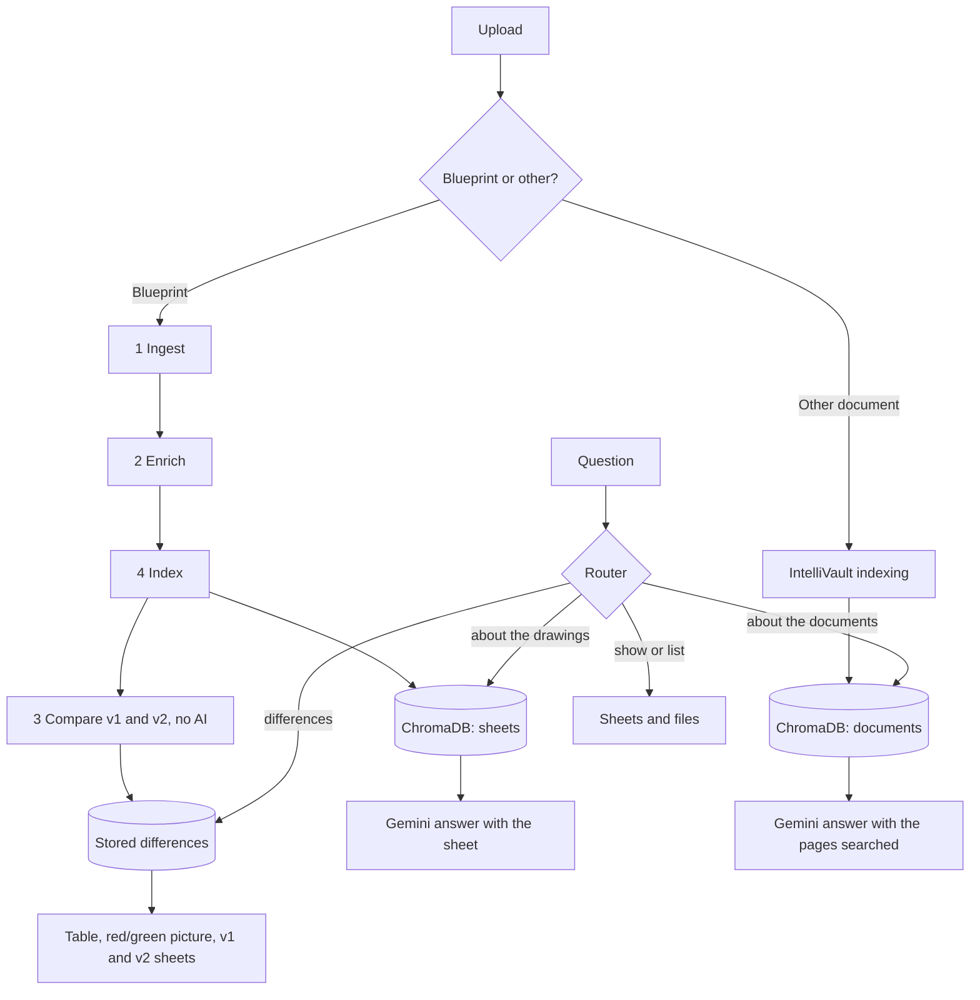

# Blueprint RAG

A Windows desktop app for construction projects. Upload drawing sets and other project documents, then chat with them:

- **See sheets:** "show A101", "open the second floor plan"
- **See what changed between two versions:** "what is the difference between v1 and v2", "show me the differences in A101"
- **Ask about the drawings:** "what MERV filters are required for the air handling units?"
- **Ask about contracts, quotes and manuals:** "what is the contract price?"
- **Open files:** "give me the v2 set", "show me the contract"

The app, its database and your files stay on your PC. The content being indexed or asked about is sent to the Google
Gemini API, using your own key.

## Install

**Requirements:** Windows 10 or 11, internet access, and a [Gemini API key](https://aistudio.google.com/apikey).

1. Run `BlueprintRAG-Setup.exe`. It is not code-signed, so Windows SmartScreen may warn: **More info → Run anyway**.
2. Enter your Gemini API key when the app starts for the first time.
3. The app opens in your browser. Use the tray icon to reopen it, see the log, or quit.

## Use

1. Click **Upload documents**, choose a project, and say what the files are:

   | Type | Use it for | File types |
   |---|---|---|
   | **Blueprint** | Drawing sets | PDF |
   | **Other document** | Contracts, quotes, manuals, photos | PDF, PNG, JPG |

2. Wait for the progress bars. An interrupted project shows **Continue indexing** at the next start; nothing is indexed
   without you asking for it.
3. Open the project and ask.

To compare two versions, upload both PDFs to one project with the same name except for `v1` and `v2`, for example
`Set v1.pdf` and `Set v2.pdf`.

## How it works



| Step | File | What it does |
|---|---|---|
| Ingest | `1_ingest_pdf.py` | Reads each page's text and renders it at 200 DPI, in parallel processes. Sheet number, title, date and revisions are read by their position in the title block |
| Enrich | `2_enrich_async.py` | Gemini describes each sheet. Code then checks the names against the PDF text and marks the rest as unconfirmed |
| Compare | `3_diff_versions.py` | Finds added, removed and moved text, plus drawing changes as a red/green picture |
| Index | `4_index_chroma.py` | Stores the full text of every sheet with Gemini embeddings in ChromaDB |
| Answer | `5_query_rag.py` | Finds sheets by keyword (BM25) and meaning, fused with RRF. Gemini gets the text of 5 sheets and the images of 3 |
| Documents | `backend/rag_pipeline.py` | The IntelliVault engine: 800-character chunks, Gemini embeddings, ChromaDB. Scans and images are read by Gemini |
| Router | `backend/router.py` | One Gemini call picks the action for each request |
| App | `pipeline.py`, `backend/main.py`, `frontend/app.py`, `launcher.py` | Runs the steps; FastAPI backend, Streamlit interface, tray icon |

A project with only other documents uses IntelliVault's own router instead of `backend/router.py`.

### No information is better than wrong information

- Differences between versions are computed from the PDFs, never written by AI. Sheets that can't be compared safely are
  listed as "Check by hand".
- A sheet number that can't be read is stored as `UNKNOWN_Pnnn`, not guessed, until Enrich finds one that is printed on
  the sheet.
- AI answers carry a note, and answers about documents list the pages that were searched.
- Document pages read by AI (scans and images) are marked in the answer.

## Known limits

- AI answers can be wrong, especially about positions on a drawing and tables that are drawn as pictures. Check them
  against the sheet.
- The comparison can miss very small changes, and a shifted stamp can show up as a change.
- A question is answered from the drawings or from the documents, not from both at once.
- A scanned document page that Gemini can't read is skipped, with only a line in the log.
- A single file can't be deleted or changed to another type yet, only the whole project.
- `6_eval_ragas.py` and `goldenset.py` were written for an earlier version and no longer match the app.

## Develop

```powershell
uv venv venv --python 3.12
.\venv\Scripts\Activate.ps1
uv pip install -r requirements-build.txt
python launcher.py
```

The app asks for a Gemini key once. The step tests read it from `.env` (copy `.env.example`).

| Task | Command |
|---|---|
| Test the app (no Gemini calls) | `python tests/7_app/run.py` |
| Test one step | see [tests/README.md](tests/README.md) |
| Build the app | `.\build.bat` → `dist\BlueprintRAG\` |
| Build the installer ([Inno Setup 6](https://jrsoftware.org/isinfo.php)) | `& "C:\Program Files (x86)\Inno Setup 6\ISCC.exe" installer.iss` → `Output\BlueprintRAG-Setup.exe` |

Quit the app before building, or the `dist` folder is locked.

### Settings (environment variables)

| Variable | Default | Meaning |
|---|---|---|
| `GEMINI_MODEL` | `gemini-3.5-flash-lite` | Model for every Gemini call except embeddings |
| `GEMINI_CONCURRENCY` | `20` | Enrich requests at the same time; lower it on slow connections |
| `INGEST_WORKERS` | `6` | Processes for reading and rendering pages; lower it on PCs with little memory |

### Where data is stored

Everything is in `%LOCALAPPDATA%\BlueprintRAG`, never in the install folder:

| Path | Contents |
|---|---|
| `projects\` | Uploaded files, one folder per project (other documents in `_documents`) |
| `blueprint_data\` | Rendered sheets, comparisons and the ChromaDB database |
| `app.log`, `console.log` | Log files |
| `query_log.txt` | Questions about other documents and the text found for them |
| `gemini_key.txt` | Your API key, in plain text |
